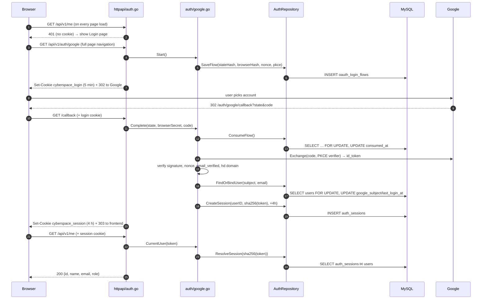
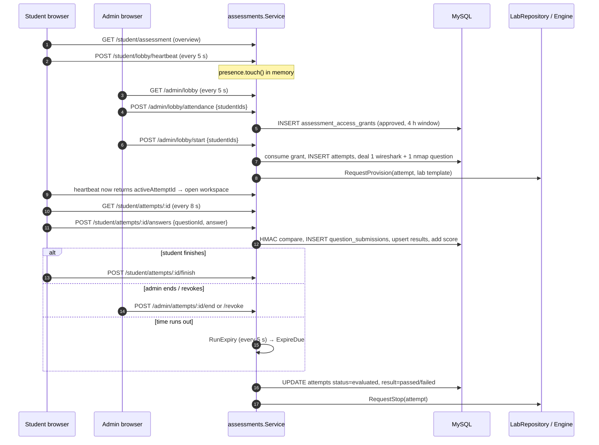
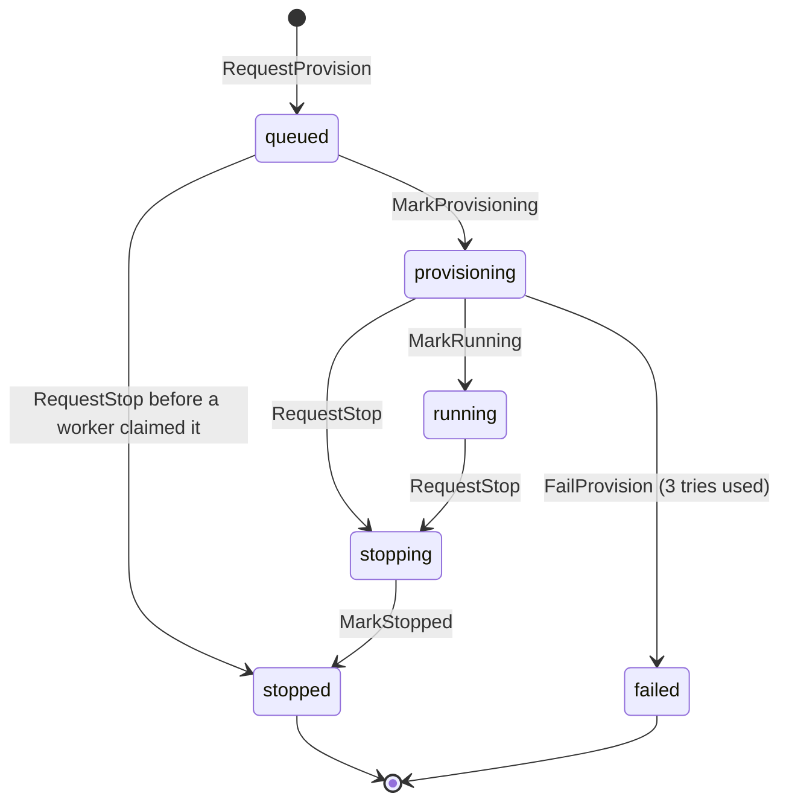

# CyberSpace — Program Flows

This document traces every request from the browser to the database and Docker and back. It covers three flows:

1. **Login**: Google sign-in, the session, and logout
2. **Assessment**: the student and admin sides, from the portal to the final score
3. **Docker automation**: how a lab container is started, stopped, retried and cleaned up

Notation used below:

| Mark | Meaning |
| --- | --- |
| `R` | Database **read** (`SELECT`) |
| `W` | Database **write** (`INSERT` / `UPDATE` / `DELETE`) |
| `TX` | Everything indented under it runs in **one transaction** (all or nothing) |
| `MEM` | In-memory only, no database (lost on restart) |
| `EXT` | Call to an external system (Google, Docker daemon) |
| `FOR UPDATE` | Row lock: other transactions wait until this one commits |

File paths are relative to `Server/`.

---

## 0. The layers (read this first)

Each request passes through the same four layers:

```
Browser (React, Client/src/services/*.ts)
   │  fetch(..., credentials: 'include')   ← session cookie sent automatically
   ▼
HTTP layer       internal/httpapi/*.go       parse request, middleware, map errors → status codes
   ▼
Service layer    internal/auth/google.go     the rules ("is this allowed?", "what happens next?")
                 internal/assessments/service.go
   ▼
Repository layer internal/database/*_repository.go   SQL only, no business rules
   ▼
MySQL            (+ Docker daemon, driven only by internal/labs/engine.go)
```

### Startup: `cmd/api/main.go` → `run()`

| Step | Call | What it does |
| --- | --- | --- |
| 1 | `config.Load()` | Reads env vars (DB URL, Google keys, answer key, pcap dir…) |
| 2 | `logger.New()` | zap logger |
| 3 | `database.NewMySQL()` | Opens the MySQL pool |
| 4 | `app.New()` | Dependency container (`App{Config, DB, Logger, Auth, Assessments}`) |
| 5 | `auth.NewGoogleLogin()` | **EXT** OIDC discovery against `accounts.google.com`. Startup fails if Google is unreachable |
| 6 | `assessments.NewService(AssessmentRepository, LabRepository, …)` | Fails if the answer key is shorter than 32 bytes |
| 7 | `httpapi.NewRouter(app)` | Registers all routes and middleware |
| 8 | goroutine `jobs.NewLoginFlowCleanup(...).Run()` | Every **1 h**: deletes expired login flows |
| 9 | goroutine `assessmentService.RunExpiry(ctx, 5s)` | Every **5 s**: scores attempts whose time is up |
| 10 | `docker.New()` → `labs.NewEngine(...).Run()` | **EXT** pings Docker. If it answers, starts 4 job workers and a sweep loop. Production refuses to start without Docker. Development runs without labs (they stay `queued`) |
| 11 | `httpServer.ListenAndServe()` | Serves requests until SIGINT/SIGTERM, then shuts down cleanly |

### Middleware chain (`internal/httpapi/router.go`)

Every request runs this chain before reaching a handler:

```
gin.Recovery() → InitCORS(allowedOrigins)
   └─ /api/v1/auth/google, /auth/google/callback        (public)
   └─ requireSession()            ← 1 R per request (auth_sessions ⨝ users)
        ├─ GET /me, DELETE /auth/session
        └─ requireOrigin(frontendURL)   ← non-GET must carry Origin = frontend (CSRF defence)
             ├─ /student/*  requireRole("student")
             └─ /admin/*    requireRole("admin")
```

---

## Flow 1 — Login (Google OIDC)

### Sequence



### Step by step

**1a. App load — "am I signed in?"**
`Client/src/features/auth/AuthContext.tsx` → `getCurrentUser()` → `GET /api/v1/me`
→ `requireSession()` (`internal/httpapi/auth.go:110`). If there is no cookie, it returns 401 and the client shows the login page.

**1b. Start login — `GET /api/v1/auth/google`**

```
authHandler.start                         httpapi/auth.go:27
└─ GoogleLogin.Start                      auth/google.go:76
   ├─ randomToken() ×3  → state, browserSecret, nonce   (32 random bytes each)
   ├─ oauth2.GenerateVerifier()  → PKCE verifier
   ├─ AuthRepository.SaveFlow             database/auth_repository.go:25
   │    W  INSERT oauth_login_flows (state_hash, browser_hash, nonce,
   │                                 pkce_verifier, expires_at = now+5m)
   └─ oauth.AuthCodeURL(state, S256 challenge, nonce)
← Set-Cookie cyberspace_login = browserSecret (HttpOnly, 300 s)
← 302 → accounts.google.com
```

Only **hashes** of `state` and `browserSecret` are stored, so a database dump cannot be used to finish someone's login.

**1c. Callback — `GET /api/v1/auth/google/callback?state=…&code=…`**

```
authHandler.callback                      httpapi/auth.go:51
├─ read cookie cyberspace_login (missing → 401 invalid_login)
├─ delete cookie cyberspace_login
└─ GoogleLogin.Complete                   auth/google.go:115
   ├─ AuthRepository.ConsumeFlow          auth_repository.go:42
   │    TX
   │     R  SELECT nonce, pkce_verifier FROM oauth_login_flows
   │        WHERE state_hash=? AND browser_hash=? AND consumed_at IS NULL
   │          AND expires_at > now  FOR UPDATE        (no row → ErrInvalidFlow)
   │     W  UPDATE oauth_login_flows SET consumed_at = now     ← single use
   ├─ EXT oauth.Exchange(code, PKCE verifier)  → Google token endpoint
   ├─ EXT verifier.Verify(id_token)            → signature + audience
   ├─ check idToken.Nonce == flow.Nonce
   ├─ check claims.email_verified == true
   ├─ check claims.hd == GOOGLE_ALLOWED_DOMAIN  (personal Gmail → refused)
   ├─ AuthRepository.FindOrBindUser       auth_repository.go:94
   │    TX
   │     R  SELECT … FROM users WHERE google_subject=? FOR UPDATE
   │     R  (if none) SELECT … FROM users WHERE email=? FOR UPDATE
   │        no row          → ErrAccessDenied  (no self-registration)
   │        status≠active   → ErrAccessDenied
   │        bound to other Google account → ErrAccessDenied
   │     W  UPDATE users SET google_subject=?, last_login_at=now   (first login)
   │        or UPDATE users SET last_login_at=now                   (later logins)
   ├─ randomToken() → sessionToken
   └─ AuthRepository.CreateSession        auth_repository.go:193
        W  INSERT auth_sessions (user_id, token_hash=sha256(token), expires_at=now+4h)
← Set-Cookie cyberspace_session = token (HttpOnly, 4 h)
← 303 → FRONTEND_URL
```

Error mapping: `ErrInvalidFlow` or `ErrAccessDenied` → **401** with one generic message (the real reason only goes to the log). Anything else → **503**.

**1d. Every protected request — `requireSession()`**

```
requireSession                            httpapi/auth.go:110
├─ read cookie cyberspace_session (missing → 401)
├─ GoogleLogin.CurrentUser                google.go:205
│    length ≠ 43 → ErrUnauthenticated (no DB hit)
│    AuthRepository.ResolveSession        auth_repository.go:212
│      R  SELECT u.* FROM auth_sessions s JOIN users u
│         WHERE s.token_hash=? AND revoked_at IS NULL
│           AND expires_at > now AND u.status='active'
└─ c.Set("currentUser", user)  → handlers read it via currentUser(c)
```

**1e. Logout — `DELETE /api/v1/auth/session`**

```
authHandler.logout                        httpapi/auth.go:153
├─ Origin header must equal FRONTEND_URL  (else 403 bad_origin)
├─ GoogleLogin.SignOut                    google.go:219
│    AuthRepository.RevokeSession         auth_repository.go:243
│      W  UPDATE auth_sessions SET revoked_at=now, revocation_reason='user_logout'
└─ delete cookie cyberspace_session → 204
```

**1f. Background — `LoginFlowCleanup.Run` (every 1 h)** (`internal/jobs/login_flow_cleanup.go:40`)

```
runOnce → AuthRepository.DeleteExpiredFlows(grace = 1h)    auth_repository.go:259
   loop:  W  DELETE FROM oauth_login_flows
             WHERE expires_at < now - 1h  LIMIT 1000
          stop when a batch deletes < 1000 rows
```

### Tables touched by login

| Table | Read | Written |
| --- | --- | --- |
| `oauth_login_flows` | ConsumeFlow | SaveFlow (insert), ConsumeFlow (consumed_at), cleanup (delete) |
| `users` | FindOrBindUser, ResolveSession | FindOrBindUser (google_subject, last_login_at) |
| `auth_sessions` | ResolveSession (every request) | CreateSession (insert), RevokeSession (revoked_at) |

---

## Flow 2 — Assessment (student + admin)

### The big picture



### The shared rule engine: `Service.evaluate()` (`assessments/service.go:455`)

Most student and admin calls first run `evaluate` to work out what the student may do:

```
evaluate(userID, now)
├─ AssessmentRepository.Catalog                     assessment_repository.go:60
│    R  SELECT levels ⨝ assessments ⨝ assessment_versions
│       WHERE all published  ORDER BY level sequence   (first assessment per level)
├─ AssessmentRepository.StudentState                assessment_repository.go:92
│    R  SELECT every attempt of the student (+ level_id)  ORDER BY id DESC
│         → ActiveAttemptID, PassedLevels, LastFailure per level, History (≤50)
│    R  SELECT assessment_version_id FROM assessment_access_grants
│         WHERE status='approved' AND now within eligible window  → AttendanceVersions
├─ next = first level in the catalog the student has not passed
└─ Status =
     in_progress   if an attempt is starting/in_progress
     unavailable   if the catalog is empty
     completed     if every level is passed
     cooldown      if the last failure on `next` ended < 24 h ago
     eligible      otherwise  (+ AttendanceMarked = grant exists for next.VersionID)
```

### 2A. Student side

| # | Client call (`Client/src/services/assessments.ts`) | Handler → Service | DB |
| --- | --- | --- | --- |
| 1 | `GET /student/assessment` (Assessments page, polled every 30 s) | `overview` → `Service.Overview` → `evaluate` | 3 R |
| 2 | `POST /student/lobby/heartbeat` (Lobby page, polled every 5 s) | `heartbeat` → `Service.Heartbeat` | 3 R + MEM |
| 3 | `DELETE /student/lobby` (leaving the Lobby page) | `leaveLobby` → `presence.leave` | MEM only |
| 4 | `GET /student/attempts/:id` (Workspace, polled every 8 s) | `attempt` → `Service.Attempt` | 5 R |
| 5 | `GET /student/attempts/:id/questions/:qid/pcap` | `pcap` → `Service.Pcap` | 5 R + file read |
| 6 | `POST /student/attempts/:id/answers` | `submit` → `Service.Submit` | TX: 4 R + 2–3 W |
| 7 | `POST /student/attempts/:id/finish` | `finish` → `Service.Finish` | see 2C |

**Heartbeat** (`service.go:97`)

```
Heartbeat(userID)
├─ evaluate()                                  3 R
├─ if Status == eligible → presence.touch(userID, now)     MEM  (map userID → lastSeen)
│  else                  → presence.leave(userID)          MEM
└─ return overview   ← once the admin starts the test, overview.activeAttemptId is set,
                       and LobbyPage.tsx navigates to /student/attempts/:id
```

Presence is kept **only in memory**. A student counts as "in the portal" if they sent a heartbeat in the last **30 s**.

**Load attempt** (`service.go:119`)

```
Service.Attempt(userID, attemptID)
├─ AssessmentRepository.Attempt                 assessment_repository.go:443
│    R  SELECT summary + g.user_id FROM attempts ⨝ grants ⨝ versions ⨝ assessments ⨝ levels
│    dealtQuestions(withFlags=true)             :476
│      R  SELECT attempt_questions ⨝ assessment_questions  (+ points, + solved score)
│      R  SELECT child flag questions ⨝ attempt_question_results (+ submission count)
│    labViews                                   :556
│      R  SELECT lab_instances ⨝ lab_instance_services ⨝ ip_allocations ⨝ network_addresses
│         (newest generation; IP only if status='running')
├─ owner ≠ userID → ErrNotFound (404; does not reveal that the attempt exists)
└─ if status ≠ in_progress → hide questions and lab
```

**Submit a flag** (`service.go:140`)

```
Service.Submit(userID, attemptID, flagID, answer)
├─ trim; 1..256 chars              else 400 invalid_input
├─ limiter.allow(attemptID)        MEM  max 20 per minute per attempt → 429
├─ evaluation.Digest(answerKey, answer)   HMAC-SHA256(lowercase(trim(answer)))
└─ AssessmentRepository.SubmitAnswer       assessment_repository.go:596
     TX
      R  SELECT t.status, deadline_at, score_awarded, g.user_id
         FROM attempts … WHERE t.id=?  FOR UPDATE OF t     ← serializes with finish
         wrong owner → 404 ; not in_progress or past deadline → 409 attempt_closed
      R  SELECT c.points, c.max_submissions, av.expected_hmac
         FROM assessment_questions c ⨝ attempt_questions ⨝ answer_validators
         (flag must belong to a question dealt to THIS attempt, else 404)
      R  SELECT is_solved FROM attempt_question_results   → already solved → 409
      R  SELECT COUNT(*), MAX(sequence_no) FROM question_submissions
         ≥ max_submissions → 429
      ·  correct = hmac.Equal(expected_hmac, digest)     (constant time)
      W  INSERT question_submissions (digest, is_correct, points_awarded)
      W  INSERT … ON DUPLICATE KEY UPDATE attempt_question_results (best_score, is_solved)
      W  UPDATE attempts SET score_awarded = score + points     (only if correct)
← {correct, points, score}
```

The plain-text answer is **never stored**. Only its HMAC is stored, so a database dump does not reveal any flag.

### 2B. Admin side

| # | Client call | Handler → Service | DB |
| --- | --- | --- | --- |
| 1 | `GET /admin/lobby` (Monitoring, every 5 s) | `lobby` → `Service.Lobby` | 2 R + 3 R per student |
| 2 | `POST /admin/lobby/attendance {studentIds}` | `markAttendance` → `Service.MarkAttendance` | per student, see below |
| 3 | `DELETE /admin/lobby/attendance/:studentId` | `cancelAttendance` → `Service.CancelAttendance` | 1 R + 1 W + audit |
| 4 | `POST /admin/lobby/start {studentIds}` | `start` → `Service.Start` | per student, see below |
| 5 | `GET /admin/attempts?scope=active\|recent` (5 s / 15 s) | `attempts` → `Service.Attempts` → `ListAttempts` | 3 R |
| 6 | `GET /admin/attempts/:id` | `adminAttempt` → `Service.AdminAttempt` | 5 R |
| 7 | `POST /admin/attempts/:id/end` | `end` → `Service.End` | see 2C + audit |
| 8 | `POST /admin/attempts/:id/revoke {reason}` | `revoke` → `Service.Revoke` | see 2C + audit |
| 9 | `POST /admin/attempts/:id/lab/restart` | `restartLab` → `Service.RestartLab` | see below |
| 10 | `GET /admin/question-bank` | `questionBank` → `Service.QuestionBank` | 1 R + 2 R per assessment + `os.Stat` pcap |
| 11 | `GET /admin/students?search=` | `students` → `Service.StudentRecords` | 2 R |

**Bulk actions use `Service.each()`** (`service.go:519`). For every student ID (duplicates are skipped):

```
each(actor, action, studentIDs, run)
for publicID:
├─ AssessmentRepository.StudentByPublicID   R  SELECT users ⟕ student_profiles (active student)
├─ run(student, now)                        ← the action-specific part
└─ audit()  → AssessmentRepository.Audit    W  INSERT audit_logs (actor, action, outcome,
                                                  entity, after_data JSON, ip, user_agent)
← [{studentId, ok, attemptId?, error?, warning?}, ...]   (one student failing does not stop the rest)
```

**Lobby** (`service.go:203`)

```
Lobby()
├─ presence.online(now, 30s)               MEM  (drops stale entries)
├─ AttendanceUsers                         R  SELECT approved, unexpired grants of students
├─ Students(ids = online ∪ attendance)     R  SELECT users ⟕ student_profiles
└─ per student: evaluate()                 3 R each   → eligibility, attendance, active attempt
```

**Mark attendance** (`service.go:250`)

```
run(student):
├─ presence.isOnline(student) ?   MEM  else ErrNotInLobby (student must have the portal open)
├─ evaluate() → must be eligible  else ErrNotEligible
└─ AssessmentRepository.MarkAttendance            assessment_repository.go:270
     TX
      R  SELECT id FROM users WHERE id=? FOR UPDATE      (lockUser: serializes per student)
      R  SELECT existing approved grant → if found, return (idempotent)
      W  INSERT assessment_access_grants (source='manual_admin', status='approved',
                                          eligible_from=now, eligible_until=now+4h)
+ audit "attendance.mark"
```

**Cancel attendance** (`service.go:268`): `W UPDATE assessment_access_grants SET status='revoked'`. If 0 rows change, it returns `ErrNoAttendance`. The action is audited as `attendance.cancel`.

**Start test** (`service.go:281`)

```
run(student):
├─ evaluate() → must be eligible AND AttendanceMarked
├─ AssessmentRepository.StartAttempt               assessment_repository.go:352
│    TX
│     R  lockUser (SELECT users FOR UPDATE)
│     R  SELECT COUNT(*) active attempts → >0 → ErrNotEligible
│     R  SELECT approved grant for this version   → none → ErrNoAttendance
│     W  UPDATE assessment_access_grants SET status='consumed'
│     W  INSERT attempts (status='in_progress', started_at=now,
│                         deadline_at=now+duration, max_score)
│     for pool in ["wireshark", "nmap"]:
│       R  SELECT id, code, lab_template_version_id FROM assessment_questions
│          WHERE version=? AND pool=? AND parent_question_id IS NULL
│          ORDER BY RAND() LIMIT 1                ← random question per pool
│       W  INSERT attempt_questions (attempt_id, question_id, sequence_no)
│     W  INSERT attempt_events (event='started', to='in_progress', {questions})
├─ presence.leave(student)                        MEM
├─ if the nmap question has a lab template:
│    LabRepository.RequestProvision(attemptID, templateID)  → see Flow 3, step 1
│    (failure only adds a `warning`; the attempt still stands)
+ audit "attempt.start"
```

**Restart lab** (`service.go:355`)

```
restartLab
├─ repo.Attempt → must be in_progress           5 R
├─ repo.AttemptLab                               R  SELECT MAX(lab_template_version_id)
│                                                    of the attempt's nmap question
└─ labs.RequestProvision                         → Flow 3 step 1 (new generation_no)
     existing active lab → ErrLabActive (409)
+ audit "lab.restart"
```

### 2C. End of the attempt: `Service.finish()` (`service.go:507`)

An attempt can end in four ways. All four go through `finish`:

| Trigger | Entry point | mode | Final status | Scored? |
| --- | --- | --- | --- | --- |
| Student clicks Finish | `Service.Finish` (checks owner first, 5 R) | `submit` | `evaluated` | yes |
| Admin clicks End | `Service.End` | `end` | `evaluated` | yes |
| Admin clicks Revoke (reason required) | `Service.Revoke` | `revoke` | `revoked` | no, counts as not passed |
| Deadline passes | `RunExpiry` → `ExpireDue` (every 5 s) | `expire` | `evaluated` | yes, `submitted_at = deadline` |

```
finish(attemptID, actorID, mode, reason)
├─ AssessmentRepository.FinishAttempt                 assessment_repository.go:717
│    TX
│     R  SELECT status, score_awarded, pass_score, deadline_at
│        FROM attempts … FOR UPDATE OF t
│        status ≠ in_progress → ErrAttemptClosed (409)
│     revoke:  W  UPDATE attempts SET status='revoked', ended_at, termination_reason
│     others:  result = score >= pass_score ? 'passed' : 'failed'
│              W  UPDATE attempts SET status='evaluated', result, submitted_at, ended_at
│     W  INSERT attempt_events (submitted|ended|expired|revoked, from in_progress → new)
│    then R  repo.Attempt(attemptID)   (5 R, to return the final summary)
└─ LabRepository.RequestStop(attemptID)  → Flow 3, step 4
   (if this fails it is only logged; the engine's sweep stops the lab anyway)
End / Revoke additionally:  W  INSERT audit_logs
```

**Expiry job** (`service.go:423`, started in `main.go:133`)

```
every 5 s: ExpireDue
├─ DueAttempts   R  SELECT id FROM attempts WHERE status='in_progress' AND deadline_at <= now
└─ for each id: finish(id, actor=0, "expire", "Time expired")
```

**After the attempt:** on the next overview, `evaluate` sees the result.

- **Passed**: the level goes into `PassedLevels`, and `next` becomes the next level.
- **Failed or revoked**: the student is in `cooldown` for **24 h** before they can retake the level.

### Tables touched by the assessment flow

| Table | Read by | Written by |
| --- | --- | --- |
| `levels`, `assessments`, `assessment_versions` | Catalog | — (seeded by `cmd/import-questions`) |
| `assessment_questions`, `answer_validators` | StartAttempt, dealtQuestions, SubmitAnswer, QuestionBank | — (seeded) |
| `assessment_access_grants` | StudentState, AttendanceUsers, MarkAttendance, StartAttempt | MarkAttendance (insert), CancelAttendance (revoked), StartAttempt (consumed) |
| `attempts` | nearly everything | StartAttempt (insert), SubmitAnswer (score), FinishAttempt (status/result) |
| `attempt_questions` | dealtQuestions, AttemptLab | StartAttempt |
| `question_submissions` | dealtQuestions (count), SubmitAnswer | SubmitAnswer |
| `attempt_question_results` | dealtQuestions, SubmitAnswer | SubmitAnswer (upsert) |
| `attempt_events` | — | StartAttempt, FinishAttempt |
| `audit_logs` | — | every admin action |
| `users`, `student_profiles` | StudentByPublicID, Students, StudentRecords, lockUser | — |

---

## Flow 3 — Docker automation (lab engine)

### The key idea: a database job queue

HTTP handlers **never touch Docker directly**. They only write rows to the database:

- a `lab_instances` row with a status
- an `orchestration_jobs` row with `job_type` = `provision` or `stop`

The **Engine** (`internal/labs/engine.go`) runs in the background. It claims those jobs and talks to Docker. If the API crashes halfway through a job, the job is still in the table, and a worker picks it up again after the lease runs out.



Generated columns hold the "one active" rules, enforced by unique keys:

- `lab_instances.active_attempt_id` = `attempt_id` while the status is queued, provisioning, running or stopping. **One active lab per attempt.**
- `ip_allocations.active_network_address_id` / `active_service_id` = set while `released_at IS NULL`. **One active lab per IP address.**

### Engine startup (`engine.go:74`)

```
Engine.Run(ctx)
├─ 4 × work()        ← workers, each: RunOnce(); if no job, sleep 1 s
└─ 1 × sweepLoop()   ← Sweep() now, then every 30 s
Defaults: lease 5 min, Docker op timeout 60 s, retry delay 5 s × attempt, max_attempts 3
```

### Step 1 — Request a lab: `LabRepository.RequestProvision` (`lab_repository.go:39`)

Called by `Service.Start` and `Service.restartLab`. If MySQL reports a deadlock, the transaction is retried up to 3 times.

```
TX (READ COMMITTED)
 R  SELECT id FROM docker_hosts WHERE status='online' FOR UPDATE   ← serializes all starts
 R  SELECT na.id, np.docker_host_id
    FROM network_addresses na ⨝ network_pools np ⨝ docker_hosts dh
    WHERE na.is_reserved = FALSE AND pool active AND host online
      AND address not in an active ip_allocation
      AND active labs on host < dh.max_instances
    ORDER BY na.id LIMIT 1                 ← lowest free IP (e.g. 192.168.20.182)
    no row → ErrNoFreeAddress (503 no_lab_capacity)
 R  SELECT MAX(generation_no)+1 FROM lab_instances WHERE attempt_id=?
 W  INSERT lab_instances (status='queued', generation_no)
    duplicate uq_lab_instances_one_active → ErrLabActive
 W  INSERT lab_instance_services (service_name='target', state='pending',
                                  internal_hostname='cyberspace-lab-<instanceID>')
 W  INSERT ip_allocations (network_address_id, lab_instance_service_id)   ← IP reserved
 W  INSERT orchestration_jobs (job_type='provision', status='pending',
                               idempotency_key='provision:<instanceID>')
```

### Step 2 — A worker claims the job: `Engine.RunOnce` → `ClaimJob` (`lab_repository.go:235`)

```
TX
 R  SELECT id, lab_instance_id, job_type, attempt_count, max_attempts
    FROM orchestration_jobs
    WHERE attempt_count < max_attempts
      AND ( (status='pending' AND available_at <= now)
         OR (status='running' AND locked_at < now - lease) )   ← take over a dead worker's job
    ORDER BY available_at, id LIMIT 1
    FOR UPDATE SKIP LOCKED              ← 4 workers never grab the same job
 W  UPDATE orchestration_jobs SET status='running', attempt_count+1,
                                  locked_at=now, locked_by='api'
```

The job then runs with its own timeout of 2 × 60 s. Shutdown does not cancel it, so a container is never left running without its state being recorded.

### Step 3 — Provision: `Engine.provision` (`engine.go:127`)

```
provision(job)
├─ LabRepository.LoadTarget                    lab_repository.go:376
│    R  SELECT li.status, ltv.yaml_spec, np.name (Docker network), na.ip_address
│       FROM lab_instances ⨝ lab_template_versions ⟕ services ⟕ ip_allocations
│            ⟕ network_addresses ⟕ network_pools
│    labs.ParseSpec(yaml) → Spec{Image}          (repository name must be lower case)
├─ status not queued/provisioning → CompleteJob('cancelled')   (a stop came first)
├─ LabRepository.MarkProvisioning              :419   via transition()
│    TX
│     R  SELECT status FROM lab_instances FOR UPDATE   (must be queued|provisioning)
│     W  UPDATE lab_instances SET status='provisioning', started_at
│     W  UPDATE lab_instance_services SET state='creating'
├─ EXT runtime.Remove("cyberspace-lab-<id>")   docker/runtime.go:82
│        ContainerRemove(force, volumes)  ← clears a leftover from a crashed run
├─ EXT runtime.Start(Container{Name, Image, Network:"macvlan", IP})   runtime.go:52
│        ContainerCreate(image, labels {cyberspace.managed=true,
│                         cyberspace.lab_instance_id=<id>},
│                         network macvlan, static IPv4Address)
│        ContainerStart(id)
├─ LabRepository.MarkRunning(containerID)      :438   via transition()
│    TX
│     R  SELECT status FOR UPDATE   (must be provisioning, else ErrStateChanged)
│     W  UPDATE lab_instances SET status='running', ready_at=now
│     W  UPDATE lab_instance_services SET state='running', container_id, started_at
└─ CompleteJob('succeeded')
     W  UPDATE orchestration_jobs SET status='succeeded', completed_at
```

From now on, the student's `GET /student/attempts/:id` → `labViews` returns `lab: {status: "running", ip: "192.168.20.182"}`.

**If any of these steps fails:**

```
runtime.Remove(name)                        ← undo the half-started container (fresh timeout)
notStarted(err)
├─ err is ErrStateChanged (a stop happened meanwhile) → CompleteJob('cancelled')
└─ provisionFailed
   ├─ attempt_count < 3 → RetryJob          W  UPDATE job status='pending',
   │                                           available_at = now + 5s × attempt, last_error
   └─ otherwise         → FailProvision     TX
                              W  UPDATE orchestration_jobs SET status='failed'
                              R  SELECT lab_instances status FOR UPDATE
                              finishInstance('failed'):
                                W  UPDATE lab_instances  status='failed', failure_code/message
                                W  UPDATE lab_instance_services  state='failed'
                                W  UPDATE ip_allocations  released_at=now   ← IP freed
```

The admin then sees the lab as failed on the Monitoring page and can click **Restart lab**.

### Step 4 — Request a stop: `LabRepository.RequestStop` (`lab_repository.go:165`)

Called by `Service.finish` (all four ways an attempt ends) and by the sweep.

```
TX
 R  SELECT id, status FROM lab_instances WHERE active_attempt_id=? FOR UPDATE
    no active lab → return (safe to call repeatedly)
 W  UPDATE orchestration_jobs SET status='cancelled'
    WHERE instance=? AND job_type='provision' AND status='pending'   ← withdraw an unclaimed start
 if status was 'queued' and a job was withdrawn (no container was ever created):
    finishInstance('stopped')   W lab_instances, W services, W ip_allocations.released_at
    commit, done
 W  UPDATE lab_instances SET status='stopping'
 W  INSERT orchestration_jobs (job_type='stop', key='stop:<id>')
    ON DUPLICATE KEY UPDATE … reset to 'pending' only if the old stop job had 'failed'
```

### Step 5 — Stop: `Engine.stop` (`engine.go:194`)

```
stop(job)
├─ EXT runtime.Remove("cyberspace-lab-<id>")   ContainerRemove(force)  (missing = OK)
├─ LabRepository.MarkStopped                   :461  via transition() (must be 'stopping')
│     finishInstance('stopped','removed')
│       W  UPDATE lab_instances SET status='stopped', stopped_at
│       W  UPDATE lab_instance_services SET state='removed'
│       W  UPDATE ip_allocations SET released_at=now     ← IP back in the pool
└─ CompleteJob('succeeded')
on failure: RetryJob (attempt < 3) or CompleteJob('failed'). The instance stays 'stopping'
and keeps its IP; the next sweep requeues the stop job.
```

### Step 6 — Sweep, every 30 s: `Engine.Sweep` (`engine.go:235`)

The sweep is the self-healing loop.

```
Sweep
├─ FailStaleJobs                     W  UPDATE orchestration_jobs SET status='failed'
│                                       WHERE running AND final attempt AND lease expired
├─ ExpiredAttempts                   R  SELECT li.attempt_id FROM lab_instances ⨝ attempts
│                                       WHERE lab active AND (attempt ended OR deadline passed)
│    for each → RequestStop(attemptID)   (Step 4)
└─ removeOrphans
   ├─ EXT runtime.Managed()          ContainerList(all, label cyberspace.managed=true)
   ├─ LiveInstances                  R  SELECT id FROM lab_instances
   │                                    WHERE status IN (provisioning, running, stopping)
   └─ EXT runtime.Remove(name)       for every labelled container with no live instance
```

Only containers labelled `cyberspace.managed=true` are ever touched, so nothing else on the Docker host is affected.

### Tables touched by the lab engine

| Table | Role |
| --- | --- |
| `docker_hosts` | Row lock serializes starts; `max_instances` caps concurrent labs |
| `network_pools` | Maps a host to a Docker network name (`macvlan`) and CIDR |
| `network_addresses` | The usable IPs (e.g. `.182`–`.212`); `is_reserved` excludes some |
| `ip_allocations` | Which address belongs to which service; `released_at` frees it |
| `lab_template_versions` | `yaml_spec` → Docker image |
| `lab_instances` | One row per lab start (`generation_no` increments on restart); status machine |
| `lab_instance_services` | The single `target` container: state, `container_id` |
| `orchestration_jobs` | The job queue: pending → running → succeeded / failed / cancelled |

---

## End-to-end timeline of one sitting

| Time | Who | What happens | Key writes |
| --- | --- | --- | --- |
| T−5 min | Student | Signs in with Google | `oauth_login_flows`, `users.last_login_at`, `auth_sessions` |
| T−4 min | Student | Opens the Lobby page; heartbeat every 5 s | memory only |
| T−3 min | Admin | Monitoring shows the student online → **Mark attendance** | `assessment_access_grants` (approved), `audit_logs` |
| T 0 | Admin | **Start** | grant → consumed, `attempts`, `attempt_questions` ×2, `attempt_events`, `lab_instances` (queued), `lab_instance_services`, `ip_allocations`, `orchestration_jobs` (provision), `audit_logs` |
| T+1 s | Engine | Worker claims the job → Docker create/start on macvlan | job running → succeeded; instance provisioning → running |
| T+5 s | Student | Heartbeat returns `activeAttemptId` → Workspace opens; polls every 8 s and sees the lab IP | — |
| T+… | Student | Downloads the pcap, scans the lab IP with nmap, submits flags | `question_submissions`, `attempt_question_results`, `attempts.score_awarded` |
| T+end | Student / Admin / expiry job | Finish / End / Revoke / deadline | `attempts` → evaluated or revoked, `attempt_events`, instance → stopping, `orchestration_jobs` (stop) |
| +1 s | Engine | Worker removes the container | instance → stopped, `ip_allocations.released_at` (IP reusable) |
| next | Student | Overview shows the result, the next level, or a 24 h cooldown | — |
